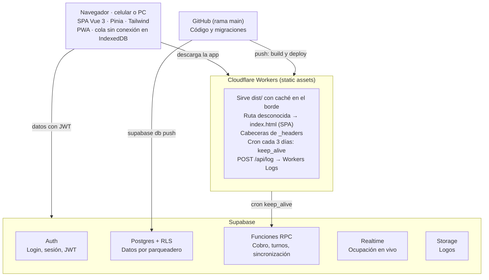

# ParkControl – Plan de implementación y Historias de Usuario

10 de noviembre de 2026 · Alejandro

ParkControl reemplaza el cuaderno de papel de un parqueadero por una web responsive: registra entradas y salidas por hora con cobro automático, controla mensualidades y vencimientos, genera comprobantes PDF y muestra los ingresos del día. Se construye como SPA en Vue 3, con Supabase como base de datos y autenticación, desplegada en Cloudflare igual que RegistroSokka.

## Contexto y alcance

ParkControl es una plataforma multi-parqueadero (SaaS): cualquier parqueadero se registra y opera con sus propios datos, tipos de vehículo y tarifas, sin ver la información de los demás. El primer cliente es un parqueadero que hoy lleva todo en papel. La app tiene que funcionar igual de bien en el celular del portero que en el PC de caja, con tema claro y oscuro.

**Problemas que resuelve**

- No se sabe con certeza qué vehículos están dentro en un momento dado.
- El cobro se calcula a mano y es propenso a errores.
- No hay control de qué mensualidades están al día, por vencer o vencidas.
- No hay un cierre de ingresos diario confiable ni comprobantes para el cliente.
- Cada parqueadero cobra distinto (por minuto, por hora, por fracción, tarifa plena) y lo debe poder cambiar él mismo.

**Roles**

| Rol | Quién es | Qué puede hacer |
| --- | --- | --- |
| Superadmin | Dueño de la plataforma (nosotros) | Crear, activar y suspender parqueaderos. No opera parqueaderos |
| Administrador | Dueño o encargado de un parqueadero | Todo dentro de su parqueadero: ajustes, tipos de vehículo, tarifas, usuarios, reportes, anulaciones |
| Operador | Portero o cajero | Registrar entradas y salidas, cobrar, registrar pagos de mensualidad, generar comprobantes, ver ocupación |

**Dentro de la v1:** alta de parqueaderos por el superadmin, aislamiento de datos por parqueadero, autenticación y roles, módulo de Ajustes (datos del negocio, tipos de vehículo, tarifas flexibles, planes mensuales, métodos de pago, ticket), parqueo por hora, ticket de entrada configurable (impresora térmica o QR), mensualidades con agenda de vencimientos, turnos de caja con entrega entre personas, operación sin conexión con sincronización, comprobantes PDF, dashboard, exportación a Excel/CSV y tema claro/oscuro.

**Fuera de la v1:** factura electrónica DIAN (prevista para una fase posterior; en la v1 basta el comprobante PDF), registro abierto de parqueaderos, un usuario en varios parqueaderos, cobro de la suscripción SaaS, pasarelas de pago en línea, envío automático de recordatorios (WhatsApp, SMS o correo), lectura automática de placas por cámara, app nativa y dominio propio (se compra en Cloudflare después de la beta).

## Arquitectura



No hay servidor propio: Cloudflare entrega los archivos estáticos de la SPA y el navegador habla directamente con Supabase usando el JWT del usuario. La seguridad depende de las políticas RLS y de las funciones RPC, no del frontend.

## Stack tecnológico

Se mantiene el mismo stack de RegistroSokka para reutilizar conocimiento y la forma de desplegar. No hace falta un backend propio: Supabase cubre base de datos, autenticación, aislamiento por parqueadero (RLS) y tiempo real.

| Capa | Tecnología | Uso |
| --- | --- | --- |
| Frontend | Vue 3 (Composition API, `<script setup>`) + Vite 5 | SPA |
| Estado | Pinia | Sesión, parqueadero, ajustes, turno abierto, estado de conexión, tema |
| Rutas | Vue Router 4 (history mode) | Rutas protegidas por rol con guards |
| Estilos | Tailwind CSS 3 con `darkMode: 'class'` | Mobile-first, responsive, tema claro/oscuro |
| PWA | vite-plugin-pwa (Workbox) | Obligatoria: la app abre y opera sin internet, instalable en celular y PC |
| Almacenamiento local | Dexie.js (IndexedDB) | Datos de referencia en caché y cola de operaciones pendientes por sincronizar |
| Base de datos | Supabase Postgres (plan Free) | Tablas, vistas y funciones RPC |
| Autenticación | Supabase Auth (email + contraseña) | Login, sesión; rol y parqueadero en `profiles` con tolerancia offline |
| Seguridad | Row Level Security (RLS) en todas las tablas, filtrando por `parqueadero_id` | Aislamiento entre parqueaderos y permisos por rol |
| Lógica crítica | Funciones SQL (`security definer`) con `supabase.rpc()` | Cobro, turnos, consecutivos, sincronización |
| Lógica compartida | `src/domain/` (JavaScript puro) | El mismo cálculo de cobro y periodos que la base de datos, para operar sin conexión |
| Pruebas de dominio | Vitest | Pruebas unitarias automatizadas para `src/domain/` (casos de borde, bisiestos, redondeos, franjas) |
| Tiempo real | Supabase Realtime | Ocupación y turno actualizados entre dispositivos |
| QR | `qrcode` (generar) + `qr-scanner` (leer con la cámara) | Ticket de entrada y salida escaneando el QR |
| Impresión | CSS `@page` de 58 u 80 mm + `window.print()` | Tickets y comprobantes en impresora térmica con su driver instalado |
| PDF | jsPDF + jspdf-autotable (en el navegador) | Comprobantes descargables |
| Exportación | SheetJS (`xlsx`) o CSV nativo | Reportes a Excel |
| Fechas y Horas | dayjs con plugins `utc` y `timezone` | Zona horaria del parqueadero (`America/Bogota`) y cálculo de desfase de reloj (clock drift) |
| Hosting | Cloudflare Workers con static assets + Workers Builds | Despliegue automático desde GitHub |
| Tareas programadas | Cloudflare Cron Triggers (en el mismo Worker) | Mantener activa la base de datos del plan Free. Workers Logs guarda los errores enviados por el navegador |
| Backups | GitHub Actions + `supabase db dump` | Copia semanal, porque el plan Free no trae backups diarios |
| Migraciones | Supabase CLI (`supabase/migrations`) | Esquema versionado en el repo |

**Decisiones de arquitectura**

1. **Multi-tenant con una sola base de datos.** Toda tabla de negocio lleva `parqueadero_id`. La función SQL `mi_parqueadero_id()` lee el parqueadero del usuario autenticado y cada política RLS filtra con ella. Solo el superadmin crea parqueaderos y cada usuario pertenece a un solo parqueadero (`profiles.parqueadero_id`, sin tabla intermedia).
2. **Nada de precios en el código.** Tipos de vehículo, tarifas, planes mensuales y métodos de pago son datos que cada parqueadero administra desde Ajustes.
3. **Operación de patio sin conexión (offline-first).** Se confía en que casi siempre hay internet, pero la operación no se detiene si se cae:
   - La PWA guarda la app en el dispositivo, así que abre sin internet si el usuario ya había iniciado sesión.
   - En IndexedDB se mantiene una copia de tarifas, tipos de vehículo, métodos de pago, mensualidades activas, vehículos dentro y turno abierto.
   - Entradas, salidas, pagos de mensualidad, avisos y movimientos de turno se guardan primero en una cola local, cada uno con un UUID generado en el dispositivo y la hora del dispositivo ajustada.
   - Al volver la conexión, la cola se envía en orden a la RPC `sincronizar_operaciones`, que es idempotente: reenviar la misma operación no la duplica.
   - Ajustes, usuarios, reportes y el consecutivo oficial de comprobantes requieren conexión.
   - **Gestión de sesión resiliente offline:** el cliente de Supabase Auth no debe colapsar la app si no puede refrescar el token JWT mientras está sin conexión (`autoRefreshToken` pausado o controlado). La sesión local se mantiene viva para operar en patio mientras no haya internet.
4. **El servidor tiene la última palabra sobre el cobro.** En línea, el valor lo calcula la RPC. Sin conexión, lo calcula `src/domain/cobro.js` con el mismo algoritmo y las mismas pruebas que la función SQL. Al sincronizar, el servidor recalcula; si hay diferencia se respeta lo cobrado y el registro queda marcado para revisión del admin.
5. **Pruebas unitarias de lógica de negocio (Vitest).** Todo el código de `src/domain/` (`cobro.js` y `periodo.js`) está respaldado por suites completas de pruebas unitarias con Vitest, probando casos extremos (cambios de tarifa nocturna, topes diarios, minutos de gracia, meses de 28/30/31 días y años bisiestos) para asegurar paridad 1:1 con las funciones SQL.
6. **La capacidad informa, no bloquea.** Los mensuales cuentan en la capacidad general. Como no todos están presentes siempre, el parqueadero puede recibir más vehículos por hora y quedar en sobrecupo aparente (ej. 42/40). Al llegar al límite solo se advierte y el encargado decide.
7. **Todo el dinero pasa por un turno de caja.** No se puede cobrar sin turno abierto, hay un solo turno abierto por parqueadero y su duración es libre: el parqueadero puede operar 24 horas con turnos irregulares de unas 12 horas. El turno termina cuando la persona que llega recibe la caja.
8. **Hora del servidor y control de desfase horario (clock drift).** Todo se guarda en `timestamptz` (UTC) y se muestra en la zona del parqueadero (`America/Bogota`). Las operaciones hechas sin conexión conservan la hora del dispositivo y quedan marcadas con `hora_origen = 'dispositivo'`. Además:
   - El frontend mide la diferencia entre la hora del dispositivo y la hora del servidor en cada conexión (a través del encabezado HTTP `Date` o llamadas de sincronización).
   - Si se detecta un desajuste superior a 5 minutos entre el reloj del dispositivo móvil y el servidor, se notifica una advertencia visual al operador y se aplica el factor de corrección (offset) para evitar cálculos erróneos durante el periodo offline.
9. **Dinero en pesos enteros** (`integer`; moneda configurable, por defecto COP).
10. **Nada se borra.** Registros, pagos y turnos se anulan o corrigen con motivo y usuario; tipos, tarifas y métodos de pago se desactivan.
11. **Tema claro/oscuro con tokens.** Colores definidos como variables CSS en `:root` y `.dark`, usados desde Tailwind. Por defecto sigue `prefers-color-scheme` y la elección del usuario se guarda en `localStorage`. El PDF y el ticket siempre salen en claro.
12. **Supabase Free con mantenimiento.** Un Cron Trigger de Cloudflare llama cada 3 días a la RPC `keep_alive` para que el proyecto no se pause por inactividad. Una GitHub Action hace un `supabase db dump` semanal como backup.
13. **Desacoplamiento estricto de capas y organización modular.** Se organiza por dominios en `src/modules/<dominio>/`. Los componentes Vue y vistas **nunca consumen directamente a Supabase** (`supabase.from` ni `supabase.rpc`). Toda comunicación se realiza a través de Servicios y Stores de Pinia (`src/modules/<dominio>/services/`), los cuales encapsulan la lógica de conexión y deciden transparentemente si despachan hacia Supabase o hacia Dexie / cola offline.
14. **Sin herramienta externa de monitoreo: todo queda en los logs de Cloudflare.** Se activa Workers Logs (`[observability]` en `wrangler.toml`). El frontend envía sus errores (`app.config.errorHandler`, `window.onerror`, `unhandledrejection` y fallos de sincronización) a `POST /api/log`, que el Worker escribe con `console.error`. Se consultan en Cloudflare → Workers → parkcontrol → Logs. Los errores de base de datos quedan en los logs de Supabase y los conflictos de sincronización en `operaciones_sync`.

## Modelo de datos

Quince tablas y tres vistas cubren la v1. Todas tienen `id uuid default gen_random_uuid()`, `created_at timestamptz default now()` y RLS activado. Todas salvo `parqueaderos` llevan `parqueadero_id` con índice. Las tablas que reciben operaciones sin conexión aceptan el `id` generado en el dispositivo, así un reenvío no duplica filas.

| Tabla | Campos clave | Reglas |
| --- | --- | --- |
| `parqueaderos` | `nombre`, `nit`, `direccion`, `telefono`, `logo_url`, `zona_horaria`, `moneda`, `dias_aviso_vencimiento` (por defecto 5), `texto_pie_comprobante`, `modo_ticket` (`termica` \| `qr` \| `ninguno`), `ancho_ticket_mm` (58 \| 80), `estado` (`activo` \| `suspendido`) | Solo el superadmin crea parqueaderos y cambia `estado`. El admin edita el suyo |
| `profiles` | `id` (= `auth.users.id`), `parqueadero_id`, `nombre`, `rol` (`superadmin` \| `admin` \| `operador`), `activo` | Un usuario pertenece a un solo parqueadero. Solo el admin de ese parqueadero cambia rol o `activo` |
| `tipos_vehiculo` | `nombre` (Carro, Moto, Bicicleta, Camioneta…), `icono`, `capacidad`, `orden`, `activo` | Nombre único por parqueadero. La capacidad es referencia, no bloquea |
| `tarifas` | `tipo_vehiculo_id`, `nombre`, `modalidad`, `valor`, `minutos_fraccion`, `minutos_gracia`, `tope_por_24h`, `es_predeterminada`, `franja_inicio`, `franja_fin` (opcionales, tarifa nocturna), `activa` | Varias por tipo, una predeterminada. Ver modalidades y tarifa nocturna abajo |
| `planes_mensuales` | `tipo_vehiculo_id`, `nombre`, `valor`, `tipo_periodo` (`mensual` \| `dias_fijos`), `duracion_dias`, `dias_gracia_pago`, `activo` | Ver "Mensualidad como tipo de cobro" abajo |
| `metodos_pago` | `nombre` (Efectivo, Nequi, Daviplata, Tarjeta…), `es_efectivo`, `orden`, `activo` | Cada parqueadero define los suyos. `es_efectivo` define qué suma al efectivo esperado del turno. Al crear el parqueadero se siembra "Efectivo" |
| `clientes` | `nombre`, `documento`, `telefono`, `email` | Documento único por parqueadero |
| `vehiculos` | `placa`, `tipo_vehiculo_id`, `cliente_id` (puede ser nulo), `marca`, `color` | Placa normalizada y única por parqueadero |
| `mensualidades` | `cliente_id`, `vehiculo_id`, `plan_id`, `dia_corte`, `fecha_inicio`, `fecha_fin`, `activa` | Un vehículo tiene como máximo una mensualidad activa |
| `pagos_mensualidad` | `mensualidad_id`, `turno_id`, `periodo_desde`, `periodo_hasta`, `valor`, `metodo_pago_id`, `usuario_id`, `anulado`, `motivo_anulacion` | Al registrar un pago se extiende `fecha_fin` |
| `registros` | `placa`, `tipo_vehiculo_id`, `tarifa_id`, `vehiculo_id`, `entrada_at`, `salida_at`, `es_mensual`, `tarifa_snapshot jsonb`, `minutos`, `valor`, `valor_servidor`, `requiere_revision`, `metodo_pago_id`, `turno_entrada_id`, `turno_salida_id`, `usuario_entrada`, `usuario_salida`, `hora_origen` (`servidor` \| `dispositivo`), `estado` (`abierto` \| `cerrado` \| `anulado`), `motivo_anulacion` | Índice único parcial: una placa no puede tener dos registros `abierto` en el mismo parqueadero |
| `turnos_caja` | `usuario_id`, `abierto_at`, `base_inicial`, `cerrado_at`, `efectivo_esperado`, `efectivo_contado`, `diferencia`, `observacion`, `recibido_por`, `recibido_at`, `efectivo_recibido`, `estado` (`abierto` \| `por_recibir` \| `cerrado`) | Un solo turno `abierto` o `por_recibir` por parqueadero. La base del turno nuevo es el efectivo recibido |
| `movimientos_caja` | `turno_id`, `tipo` (`retiro` \| `ingreso_manual`), `valor`, `motivo`, `usuario_id` | Retiros de efectivo (ej. el dueño recoge plata) y otros ingresos, siempre con motivo |
| `comprobantes` | `consecutivo`, `origen` (`registro` \| `pago_mensualidad`), `origen_id`, `cliente_nombre`, `cliente_documento`, `valor`, `usuario_id` | Consecutivo propio de cada parqueadero, asignado en la base de datos; nunca se reutiliza |
| `operaciones_sync` | `id` (UUID del dispositivo), `tipo`, `payload jsonb`, `dispositivo`, `usuario_id`, `creada_en_dispositivo_at`, `procesada_at`, `resultado` (`ok` \| `conflicto` \| `error`), `detalle` | Bitácora de lo que llegó por sincronización. Los conflictos los revisa el admin |

Tabla adicional para el seguimiento de cobros: `avisos_mensualidad` (`mensualidad_id`, `periodo_hasta`, `medio` (`llamada` | `en_persona` | `mensaje`), `nota`, `usuario_id`). Guarda cada aviso hecho a un cliente sobre su vencimiento (HU-19).

**Modalidades de tarifa** (configurables desde Ajustes)

| Modalidad | Cómo cobra | Campos que usa |
| --- | --- | --- |
| `por_minuto` | `minutos × valor` | `valor`, `minutos_gracia`, `tope_por_24h` |
| `por_hora` | `ceil(minutos / 60) × valor` | `valor`, `minutos_gracia`, `tope_por_24h` |
| `por_fraccion` | `ceil(minutos / minutos_fraccion) × valor` (fracción de 15, 30 min…) | `valor`, `minutos_fraccion`, `minutos_gracia`, `tope_por_24h` |
| `plena` | Valor fijo por cada 24 h o fracción (día pleno, noche, evento) | `valor` |

En todas: si los minutos son menores o iguales a `minutos_gracia`, el valor es 0. Si hay `tope_por_24h`, cada bloque completo de 24 h se cobra como máximo ese tope. Ejemplo `por_hora` a $3.000, gracia 5 min, tope $25.000: 1 h 10 min cuesta $6.000 y 26 h cuestan $25.000 + $6.000 = $31.000.

**Tarifa nocturna (opcional).** Una tarifa puede tener `franja_inicio` y `franja_fin` (ej. 19:00 y 07:00, en la hora local del parqueadero). Si el tipo de vehículo tiene una tarifa con franja activa, `calcular_cobro` parte la estancia en tramos: cada tramo dentro de la franja se cobra con la tarifa nocturna (una `plena` cobra su valor una vez por noche) y los tramos fuera de la franja con la tarifa general. El `tarifa_snapshot` guarda ambas tarifas y el desglose. Si el parqueadero no configura franja, todo se cobra con la tarifa general.

**Mensualidad como tipo de cobro**

Además del cobro por tiempo, cada parqueadero configura en Ajustes sus planes de mensualidad. El vehículo mensual entra y sale sin pagar por tiempo mientras su periodo esté pago. Un plan define cómo se cuenta el periodo:

- **`mensual` (periodo dinámico por cliente):** cada mensualidad se cobra desde su propio día de inicio hasta el mismo día del mes siguiente. Si un cliente entra el 20, paga del 20 al 20; si otro entra el 3, del 3 al 3. No hay un corte común: cualquier día del mes puede haber mensualidades venciendo. Ese día se guarda en `dia_corte` al crear la mensualidad.
- **Meses cortos:** si el mes no tiene el día de cobro (29, 30 o 31), el periodo termina el último día de ese mes y el siguiente vuelve al día original (31 ene → 28 feb → 31 mar).
- **`dias_fijos`:** para quien cobre por quincena o semana, el periodo dura N días desde el inicio (15, 7…).
- **Vencimiento:** `fecha_fin` es el día del próximo cobro. La mensualidad está `por_vencer` desde `dias_aviso_vencimiento` días antes y `vencida` cuando pasan `dias_gracia_pago` días después de `fecha_fin` sin pago.
- **Saber qué se vence:** como cada cliente tiene su propio día, el sistema no depende de recordar cortes. Calcula `fecha_fin` de cada mensualidad y la Agenda de vencimientos (HU-17) las agrupa en vencidas, hoy, mañana, próximos 7 días y un calendario del mes.

| Cliente de ejemplo | Plan | Inicio | Periodos que genera |
| --- | --- | --- | --- |
| Ana | Mensual carro (`mensual`) | 20 nov 2026 | 20 nov – 20 dic, 20 dic – 20 ene, 20 ene – 20 feb |
| Luis | Mensual carro (`mensual`) | 3 dic 2026 | 3 dic – 3 ene, 3 ene – 3 feb |
| Marta | Mensual moto (`mensual`) | 31 ene 2027 | 31 ene – 28 feb, 28 feb – 31 mar, 31 mar – 30 abr |
| Pedro | Quincena carro (`dias_fijos`, 15 días) | 3 nov 2026 | 3 nov – 18 nov, 18 nov – 3 dic |

El cálculo de periodos vive en la función SQL `calcular_periodo(plan_id, dia_corte, desde)`, que usan la creación de mensualidades, el registro de pagos y el simulador de Ajustes.

**Vistas**

- `v_ocupacion_actual`: registros `abierto` con minutos transcurridos y valor estimado, más ocupados y capacidad por tipo. Puede mostrar sobrecupo (ej. 42/40).
- `v_estado_mensualidades`: cada mensualidad con `dias_restantes` y `estado`: `al_dia`, `por_vencer` (de 0 a `dias_aviso_vencimiento` días) o `vencida`.
- `v_resumen_turno`: por turno, vehículos que entraron y salieron, cobros por hora y pagos de mensualidad por método de pago, retiros, efectivo esperado y diferencia.

**Funciones RPC**

- `crear_parqueadero(nombre, nit, ..., email_admin)`: solo superadmin. Crea el parqueadero, siembra tipos, una tarifa y el método "Efectivo" de ejemplo, e invita al admin.
- `registrar_entrada(id, placa, tipo_vehiculo_id, tarifa_id)`: normaliza la placa, detecta mensualidad vigente y que no esté ya dentro. Si se supera la capacidad no bloquea: devuelve una advertencia.
- `calcular_cobro(registro_id, tarifa_id?)`: devuelve minutos y valor sin cerrar.
- `registrar_salida(registro_id, metodo_pago_id, tarifa_id?)`: exige turno abierto, cierra el registro y guarda valor y `tarifa_snapshot`.
- `registrar_pago_mensualidad(id, mensualidad_id, plan_id, metodo_pago_id)`: exige turno abierto, crea el pago y extiende la vigencia según el tipo de periodo del plan.
- `abrir_turno(base_inicial)`, `entregar_turno(efectivo_contado, observacion)`, `recibir_turno(turno_id, efectivo_recibido)` y `registrar_movimiento_caja(tipo, valor, motivo)`.
- `sincronizar_operaciones(operaciones jsonb)`: recibe la cola del dispositivo y aplica cada operación en orden con las RPC anteriores. Si un `id` ya existe, no hace nada. Recalcula los cobros hechos sin conexión y registra el resultado en `operaciones_sync`.
- `crear_comprobante(origen, origen_id, cliente_nombre, cliente_documento)`: asigna el consecutivo.
- `anular_registro(id, motivo)` y `anular_pago(id, motivo)`: solo admin.
- `keep_alive()`: devuelve 1. La llama el Cron Trigger para mantener activo el proyecto Free.

## Vistas de la aplicación

La app tiene 22 vistas. En PC la navegación es un menú lateral; en el celular, una barra inferior con Inicio, Ocupación, Mensualidades, Caja y Más. El encabezado muestra:

- El nombre del parqueadero.
- El turno abierto (quién lo tiene y desde qué hora).
- El estado de conexión: "En línea", o "Sin conexión · N pendientes" con la cantidad de operaciones esperando sincronizarse.
- El indicador de alerta horaria (si se detecta desfase de reloj local contra el servidor > 5 min).
- El selector de tema y el menú del usuario.

Las tablas pasan a tarjetas por debajo de 640 px. Las vistas marcadas "Sin conexión: sí" funcionan sin internet.

| Ruta | Vista | Quién la ve | Qué muestra y qué se hace | Sin conexión | HU |
| --- | --- | --- | --- | --- | --- |
| `/login` | Iniciar sesión | Pública | Email y contraseña. No hay registro público | No | HU-02 |
| `/recuperar` | Recuperar contraseña | Pública | Envío del correo y nueva contraseña | No | HU-02 |
| `/` | **Dashboard** | Admin y operador | Semáforo de vencimientos, clientes para avisar, ocupación; el admin ve además ingresos y gráficas | Parcial (datos en caché) | HU-17, HU-19, HU-23 |
| `/ocupacion` | Ocupación | Admin y operador | Ocupados/capacidad por tipo (con sobrecupo visible), vehículos dentro, buscador de placa, botones Entrada, Salida y Escanear QR | Sí | HU-12 |
| `/ocupacion/entrada` | Registrar entrada | Admin y operador | Placa, tipo y tarifa; aviso de mensual vigente o vencido y de capacidad superada; imprime o muestra el ticket | Sí | HU-11, HU-27 |
| `/ocupacion/salida/:id` | Cobrar salida | Admin y operador | Llega por placa o por QR. Tiempo, tarifa, valor, método de pago, vuelto y comprobante | Sí | HU-13, HU-20 |
| `/historial` | Historial | Admin y operador | Registros por placa y fechas; el admin puede anular | No | HU-14, HU-15 |
| `/mensualidades` | Mensualidades | Admin y operador | Pestañas Agenda, Calendario del mes y Todas | Parcial (lectura) | HU-17 |
| `/mensualidades/nueva` | Nueva mensualidad | Admin y operador | Cliente, vehículo, plan, fecha de inicio, vista previa del periodo y primer pago | No | HU-16 |
| `/mensualidades/:id` | Detalle de mensualidad | Admin y operador | Cliente, vehículo, periodo actual, pagos, avisos, Registrar pago y Marcar avisado | Sí (pago y aviso) | HU-18, HU-19 |
| `/caja` | Caja y turno | Admin y operador | Abrir turno con base, resumen del turno en curso, retiros, entregar turno y recibir turno | Sí | HU-24 |
| `/caja/turnos` | Historial de turnos | Admin | Turnos cerrados con resumen, diferencias y quién entregó y recibió | No | HU-24 |
| `/comprobantes` | Comprobantes | Admin | Lista por consecutivo, filtros y nueva descarga | No | HU-22 |
| `/reportes` | Reportes | Admin | Ingresos por rango, revisión de conflictos de sincronización y exportación | No | HU-25, HU-26 |
| `/ajustes/negocio` | Ajustes · Negocio | Admin | Datos, logo, zona horaria, días de aviso, pie del comprobante | No | HU-06 |
| `/ajustes/vehiculos` | Ajustes · Tipos de vehículo | Admin | Tipos y capacidad | No | HU-07 |
| `/ajustes/tarifas` | Ajustes · Tarifas | Admin | Tarifas por tipo y modalidad, con simulador | No | HU-08 |
| `/ajustes/planes` | Ajustes · Planes mensuales | Admin | Planes, tipo de periodo y días de gracia, con simulador | No | HU-09 |
| `/ajustes/pagos` | Ajustes · Métodos de pago | Admin | Crear, ordenar y desactivar métodos; marcar cuáles son efectivo | No | HU-06 |
| `/ajustes/ticket` | Ajustes · Ticket | Admin | Modo (térmica, QR o ninguno), ancho 58/80 mm, vista previa e impresión de prueba | No | HU-27 |
| `/ajustes/usuarios` | Ajustes · Usuarios | Admin | Invitar, cambiar rol, desactivar | No | HU-03 |
| `/superadmin` | Parqueaderos | Superadmin | Crear parqueaderos, ver su estado y activar o suspender | No | HU-01, HU-05 |

### Dashboard en detalle

El Dashboard es la primera pantalla del día: muestra en el semáforo a quién hay que cobrar y en la lista a quién falta avisar. De arriba abajo:

1. **Semáforo de vencimientos.** Tres tarjetas grandes, cada una con conteo y valor total:
   - **Rojo — Vencidas:** pasó la fecha de cobro más los días de gracia sin pago.
   - **Amarillo — Por vencer:** vencen desde hoy hasta los próximos N días (N = días de aviso en Ajustes, por defecto 5). Indica aparte cuántas vencen hoy.
   - **Verde — Al día:** el resto de mensualidades activas.
   - Al tocar una tarjeta, la lista de abajo se filtra por ese color. Cada tarjeta lleva el texto del estado, no solo el color, y se lee bien en tema claro y oscuro.
2. **Clientes para avisar.** Lista de vencidas y por vencer, ordenada por fecha de cobro (la más urgente primero). Cada fila muestra:
   - Punto de color del semáforo.
   - Cliente y placa.
   - Teléfono como enlace `tel:` para llamar desde el celular.
   - Fecha de cobro con texto relativo ("hoy", "en 2 días", "hace 3 días").
   - Valor.
   - Estado del aviso ("Sin avisar" o "Avisado 12 nov · llamada · Juan").
   - Botones Marcar avisado y Registrar pago.
   - El filtro "Solo sin avisar" viene activo. Cuando se registra el pago, el cliente sale de la lista.
3. **Ocupación ahora.** Cupos ocupados y libres por tipo de vehículo, con acceso directo a Entrada y Salida.
4. **Solo para el admin:**
   - Ingresos de hoy por origen (por hora y mensualidades) y por método de pago.
   - Total por cobrar en los próximos 7 días.
   - Gráfica de ingresos de los últimos 30 días.
   - Gráfica de entradas por hora.

En el celular el semáforo queda como tres tarjetas compactas en una fila y la lista se muestra en tarjetas. Los datos se refrescan con Realtime y, como respaldo, cada 60 segundos.

```text
Dashboard (escritorio, datos de ejemplo)
┌──────────────────────────┐ ┌──────────────────────────┐ ┌──────────────────────────┐
│ ROJO · Vencidas          │ │ AMARILLO · Por vencer    │ │ VERDE · Al día           │
│ 3 clientes               │ │ 6 clientes               │ │ 41 clientes              │
│ $380.000 por cobrar      │ │ 2 vencen hoy · $900.000  │ │ Sin acción pendiente     │
└──────────────────────────┘ └──────────────────────────┘ └──────────────────────────┘

Clientes para avisar                                              [ Solo sin avisar ]
   Cliente · placa        Teléfono       Vence         Valor      Aviso           Acciones
 ● Ana Gómez · ABC123     310 555 0101   hace 3 días   $150.000   Sin avisar      [Avisado] [Pagar]
 ● Luis Pérez · XYZ98D    311 555 0102   hace 1 día    $80.000    Avisado 9 nov   [Avisado] [Pagar]
 ● Marta Ruiz · DEF456    312 555 0103   hoy           $150.000   Sin avisar      [Avisado] [Pagar]
 ● Pedro Díaz · GHI789    313 555 0104   en 2 días     $150.000   Sin avisar      [Avisado] [Pagar]
   (● rojo = vencida, ● amarillo = por vencer)

┌──────────────────────────────────────────────────────────────────────────────────────┐
│ Ocupación ahora: Carros 32/40 · Motos 10/25 · Bicicletas 3/10       Entrada · Salida │
└──────────────────────────────────────────────────────────────────────────────────────┘
```

Debajo de la ocupación, solo el admin ve los ingresos de hoy, el total por cobrar en 7 días y las gráficas.

## Backlog

27 historias en 7 épicas. Prioridad: P1 = imprescindible para la beta, P2 = importante, P3 = deseable. Los sprints son de 1 semana; el Sprint 0 es la base técnica (ver Plan de implementación).

| HU | Historia | Épica | Prioridad | Sprint |
| --- | --- | --- | --- | --- | --- |
| HU-01 | Crear un parqueadero (superadmin) | 1 Acceso | P1 | 1 |
| HU-02 | Iniciar y cerrar sesión | 1 Acceso | P1 | 1 |
| HU-03 | Gestionar usuarios del parqueadero | 1 Acceso | P1 | 1 |
| HU-04 | Aislamiento de datos entre parqueaderos | 1 Acceso | P1 | 1 |
| HU-05 | Panel de superadmin | 1 Acceso | P1 | 1 |
| HU-06 | Datos del negocio y métodos de pago | 2 Ajustes | P1 | 2 |
| HU-07 | Tipos de vehículo y capacidad | 2 Ajustes | P1 | 2 |
| HU-08 | Tarifas flexibles por tipo de vehículo | 2 Ajustes | P1 | 2 |
| HU-09 | Planes mensuales | 2 Ajustes | P1 | 2 |
| HU-10 | Tema claro y oscuro | 2 Ajustes | P2 | 1 |
| HU-11 | Registrar entrada de vehículo | 3 Patio | P1 | 3 |
| HU-12 | Ver quién está dentro | 3 Patio | P1 | 3 |
| HU-13 | Registrar salida y cobrar | 3 Patio | P1 | 3 |
| HU-14 | Historial por placa | 3 Patio | P2 | 3 |
| HU-15 | Anular un registro | 3 Patio | P2 | 3 |
| HU-27 | Ticket de entrada configurable | 3 Patio | P1 | 3 |
| HU-16 | Crear mensualidad (cliente + vehículo) | 4 Mensualidades | P1 | 4 |
| HU-17 | Agenda de vencimientos de mensualidades | 4 Mensualidades | P1 | 4 |
| HU-18 | Registrar pago y renovar | 4 Mensualidades | P1 | 4 |
| HU-19 | Seguimiento de avisos de vencimiento | 4 Mensualidades | P2 | 4 |
| HU-20 | Comprobante PDF de parqueo por hora | 5 Comprobantes | P1 | 6 |
| HU-21 | Comprobante PDF de pago de mensualidad | 5 Comprobantes | P1 | 6 |
| HU-22 | Consultar y volver a descargar comprobantes | 5 Comprobantes | P2 | 6 |
| HU-23 | Dashboard con semáforo | 6 Caja y reportes | P1 | 4 |
| HU-24 | Turnos de caja: apertura, entrega y recepción | 6 Caja y reportes | P1 | 3 |
| HU-25 | Reporte de ingresos y exportación | 6 Caja y reportes | P2 | 6 |
| HU-26 | Operar sin conexión y sincronizar | 7 Sin conexión | P1 | 5 |

## Épica 1 — Acceso, usuarios y multi-parqueadero

### HU-01 Crear un parqueadero (superadmin)

**Como** superadmin **quiero** dar de alta un parqueadero nuevo y a su administrador **para** controlar quién usa la plataforma.

- No existe registro público: la ruta `/registro` no existe y la pantalla de login no ofrece crear cuenta.
- Desde `/superadmin` pulso "Nuevo parqueadero" e ingreso nombre, NIT, teléfono, dirección, nombre y email del administrador.
- Al guardar, la RPC `crear_parqueadero` crea el parqueadero con tipos de vehículo (Carro, Moto), una tarifa `por_hora` y el método de pago "Efectivo" de ejemplo, todos editables. El admin recibe un correo de invitación para definir su contraseña.
- Si el email ya pertenece a otro usuario, veo "Este correo ya está registrado" y no se crea nada, porque un usuario solo puede pertenecer a un parqueadero.
- La RPC rechaza la llamada si quien la hace no es superadmin.
- Cuando el admin entra por primera vez llega a Ajustes, con un aviso para revisar tarifas, métodos de pago y ticket.
- **Arquitectura de capas:** la invocación se realiza a través de `superadminService.crearParqueadero()`, sin llamadas directas a Supabase en la vista.

### HU-02 Iniciar y cerrar sesión

**Como** usuario **quiero** entrar con mi email y contraseña **para** acceder solo a lo que mi rol permite.

- Con credenciales correctas llego al inicio de mi rol: admin al Dashboard, operador a Ocupación.
- Con credenciales incorrectas veo "Correo o contraseña incorrectos" sin revelar cuál falló.
- Un usuario con `activo = false` o de un parqueadero `suspendido` no puede entrar y ve el motivo.
- Las rutas protegidas redirigen a `/login` sin sesión; al expirar la sesión se redirige con el mensaje "Tu sesión expiró" (mismo patrón que RegistroSokka).
- "Cerrar sesión" limpia la sesión y los stores de Pinia.
- Existe "Olvidé mi contraseña" con el flujo de recuperación de Supabase.
- **Tolerancia a sesión offline:** si un usuario ya inició sesión previamente y el dispositivo pierde la conexión a internet, la aplicación no invalida la sesión local ni expulsa al usuario por fallos al refrescar el token JWT contra el servidor (`autoRefreshToken` pausado en offline). El operador puede continuar registrando en patio de forma ininterrumpida.
- **Arquitectura de capas:** la autenticación se administra mediante `authStore` y `authService`.

### HU-03 Gestionar usuarios del parqueadero

**Como** administrador **quiero** crear operadores y desactivarlos **para** controlar quién usa el sistema.

- Veo la lista de usuarios de mi parqueadero con nombre, email, rol y estado.
- Puedo invitar un usuario con email, nombre y rol; recibe un correo para definir su contraseña (`inviteUserByEmail` desde una Edge Function o RPC segura, nunca con la service key en el navegador).
- Puedo cambiar el rol y desactivar o reactivar usuarios. No puedo desactivarme a mí mismo.
- Un operador no ve este módulo ni en el menú ni por URL.
- **Arquitectura de capas:** la vista delega la gestión a `usuariosService`.

### HU-04 Aislamiento de datos entre parqueaderos

**Como** dueño de un parqueadero **quiero** que nadie de otro parqueadero vea mis datos **para** confiar en la plataforma.

- Toda tabla de negocio tiene `parqueadero_id` y políticas RLS con `parqueadero_id = mi_parqueadero_id()` para select, insert, update y delete.
- Prueba: con dos parqueaderos A y B, un usuario de A que consulta `registros`, `clientes` o `tarifas` recibe solo filas de A, aunque envíe el id de B por la API.
- Un insert con `parqueadero_id` de otro parqueadero es rechazado.
- Las RPC `security definer` validan el parqueadero del usuario antes de leer o escribir.
- Placas, documentos y consecutivos son únicos por parqueadero, no globales.

### HU-05 Panel de superadmin

**Como** dueño de la plataforma **quiero** ver y administrar los parqueaderos **para** activarlos, suspenderlos y dar soporte.

- La ruta `/superadmin` solo es visible con rol `superadmin`. Al iniciar sesión, el superadmin llega aquí.
- Veo cada parqueadero con fecha de alta, email del admin, número de usuarios, registros del último mes y última actividad.
- Puedo cambiar el estado entre `activo` y `suspendido`; los usuarios de un parqueadero suspendido no pueden iniciar sesión.
- Puedo reenviar la invitación al admin de un parqueadero.
- El superadmin no ve clientes, placas ni montos de los parqueaderos.

## Épica 2 — Módulo de Ajustes

Todo lo que cambia de un parqueadero a otro se configura aquí, sin tocar código. Solo el administrador entra a Ajustes; el operador solo puede cambiar su tema.

### HU-06 Datos del negocio y métodos de pago

**Como** administrador **quiero** configurar los datos de mi parqueadero y los métodos de pago que acepto **para** que salgan en pantalla, en tickets y comprobantes, y para cuadrar la caja.

- Puedo editar nombre, NIT, dirección, teléfono, logo (subido a Supabase Storage, máximo 1 MB, PNG o JPG), zona horaria, moneda, días de aviso de vencimiento y texto del pie del comprobante.
- Al guardar veo "Cambios guardados" y el cambio se refleja sin recargar la página.
- Nombre y NIT son obligatorios; los campos inválidos se marcan antes de enviar.
- En `/ajustes/pagos` puedo crear, renombrar, ordenar y desactivar métodos de pago (ej. Efectivo, Nequi, Daviplata, Transferencia, Tarjeta). Para cada uno indico si es efectivo.
- Debe haber siempre al menos un método activo marcado como efectivo.
- Al cobrar solo aparecen los métodos activos, en el orden definido. En el cierre de turno, los que son efectivo suman al efectivo esperado y los demás se muestran aparte.
- **Arquitectura de capas:** toda interacción pasa por `ajustesService` y `ajustesStore`.

### HU-07 Tipos de vehículo y capacidad

**Como** administrador **quiero** definir los tipos de vehículo que recibo y cuántos cupos tengo de cada uno **para** controlar la ocupación.

- Puedo crear, editar, reordenar y desactivar tipos (ej. Carro, Moto, Bicicleta, Camioneta) con nombre, ícono y capacidad.
- No puedo crear dos tipos con el mismo nombre en mi parqueadero.
- No puedo desactivar un tipo con vehículos dentro o mensualidades activas; veo cuántos lo bloquean.
- Los tipos desactivados no aparecen al registrar entradas, pero sí en el historial.

### HU-08 Tarifas flexibles por tipo de vehículo

**Como** administrador **quiero** crear las tarifas que necesite para cada tipo de vehículo (por minuto, por hora, por fracción o plena) **para** cobrar como cobra mi negocio.

- Por cada tipo de vehículo veo sus tarifas y puedo crear, editar y desactivar.
- Al crear una tarifa elijo nombre, modalidad (`por_minuto`, `por_hora`, `por_fraccion`, `plena`) y valor. El formulario muestra solo los campos de esa modalidad: minutos por fracción, minutos de gracia y tope por 24 h.
- Un tipo puede tener varias tarifas activas (ej. "Por hora" y "Día pleno") y exactamente una predeterminada. Al marcar otra como predeterminada, la anterior deja de serlo.
- **Tarifa nocturna opcional:** puedo activar en una tarifa "Aplicar solo en una franja horaria" e indicar desde y hasta qué hora (ej. 19:00 a 07:00). Si no la activo, el tipo cobra solo con su tarifa general.
- Con tarifa nocturna activa, el cobro se divide automáticamente: el tiempo dentro de la franja se cobra con la nocturna y el resto con la general. Ejemplo: general $3.000 por hora y nocturna plena de $12.000 (19:00–07:00); entrada a las 17:00 y salida a las 08:00 del día siguiente = $6.000 + $12.000 + $3.000 = $21.000.
- Solo puede haber una tarifa con franja activa por tipo de vehículo, y las franjas no se pueden solapar.
- El formulario tiene un **simulador**: ingreso hora de entrada y de salida y veo el valor y el desglose por tramo, calculado con la misma `calcular_cobro` que usa la salida.
- Valores en pesos enteros mayores que 0; `minutos_fraccion` entre 1 y 1440.
- Editar una tarifa no cambia los registros ya cerrados (usan `tarifa_snapshot`). Los vehículos que están dentro se cobran con la tarifa vigente al salir, y Ajustes avisa: "Hay N vehículos dentro con esta tarifa".
- **Suite de pruebas unitarias automatizadas (Vitest):** el motor de cálculo `src/domain/cobro.js` cuenta con una suite completa de pruebas unitarias con Vitest que cubre todos los casos extremos (minutos de gracia, cálculo de fracciones exactas, topes de 24 horas, transiciones nocturnas y combinaciones mixtas), garantizando paridad exacta con la función SQL `calcular_cobro`.

### HU-09 Planes mensuales

**Como** administrador **quiero** definir el precio de la mensualidad por tipo de vehículo **para** cobrarla sin calcularla a mano.

- Puedo crear, editar y desactivar planes con tipo de vehículo, nombre (ej. "Mensual carro", "Quincena moto") y valor.
- Elijo el tipo de periodo: **mensual** (cada cliente paga del día en que empezó al mismo día del mes siguiente) o **días fijos** (indico cuántos días: 15, 7…). El formulario muestra solo los campos del tipo elegido.
- Puedo definir días de gracia para el pago.
- El formulario tiene un simulador: ingreso una fecha de inicio y veo los próximos 3 periodos, calculados con `calcular_periodo`.
- Al crear o renovar una mensualidad solo se ofrecen los planes activos del tipo del vehículo.
- Cambiar el valor o el tipo de periodo de un plan no altera pagos ya registrados; aplica desde el siguiente pago.
- **Suite de pruebas unitarias automatizadas (Vitest):** el motor de periodos `src/domain/periodo.js` cuenta con pruebas en Vitest que evalúan casos límite de calendario (meses de 28, 30 y 31 días, años bisiestos y planes de días fijos), asegurando paridad idéntica con la función SQL `calcular_periodo`.

### HU-10 Tema claro y oscuro

**Como** usuario **quiero** elegir tema claro, oscuro o el del sistema **para** trabajar cómodo de día y de noche.

- Hay un selector Claro / Oscuro / Sistema en el encabezado (o en el menú en el celular) y en Ajustes.
- Por defecto se usa el tema del sistema (`prefers-color-scheme`); la elección se guarda en `localStorage` y se aplica antes de pintar la página, sin parpadeo blanco.
- Todas las pantallas, modales, tablas y gráficas usan los tokens de color; no quedan textos ilegibles en ninguno de los dos temas (contraste mínimo AA).
- Los comprobantes PDF siempre salen en tema claro.

## Épica 3 — Parqueo por hora

Es la pantalla más usada: debe permitir registrar una entrada en menos de 10 segundos desde el celular, con botones grandes y el campo de placa enfocado.

### HU-11 Registrar entrada de vehículo

**Como** operador **quiero** registrar la placa y el tipo de vehículo al entrar **para** saber quién está dentro y desde qué hora.

- Escribo la placa (se convierte a mayúsculas y se quitan espacios y guiones), elijo el tipo con botones grandes y, si el tipo tiene más de una tarifa, elijo la tarifa (viene seleccionada la predeterminada).
- Si la placa ya existe en `vehiculos`, el tipo se preselecciona.
- Si la placa tiene una mensualidad vigente, se marca `es_mensual` y veo "Mensualidad al día hasta DD/MM". Si está vencida, veo una alerta y puedo registrarla como cobro por hora.
- Si la placa ya tiene un registro `abierto`, no se crea otro y veo "Este vehículo ya está dentro desde HH:MM".
- Si el tipo está en su capacidad o la supera, veo una advertencia ("Carros 40/40, ya está lleno según la capacidad") con los botones "Registrar de todas formas" y "Cancelar". La entrada nunca se bloquea: el encargado decide, porque los mensuales ausentes liberan cupos que el sistema no ve.
- Con conexión, la hora de entrada la pone el servidor. Sin conexión, se usa la hora del dispositivo compensada con el offset de desfase horario detectado y la entrada se sincroniza después (HU-26).
- Al registrar, se entrega el ticket según Ajustes: impreso, QR en pantalla o ninguno (HU-27).
- **Arquitectura de capas:** la UI llama a `ocupacionService.registrarEntrada()`, que conmuta a IndexedDB si no hay red sin que la vista lo gestione directamente.

### HU-12 Ver quién está dentro

**Como** operador **quiero** ver los vehículos que están dentro **para** saber la ocupación y encontrar rápido uno que va a salir.

- Veo ocupados y capacidad por tipo de vehículo (ej. Carros 32/40, Motos 10/25). Si se supera la capacidad se muestra el sobrecupo en ámbar (ej. 42/40), sin bloquear nada.
- Veo cuántos de los vehículos dentro son mensuales y cuántos mensuales activos no están presentes, para estimar el cupo real.
- Veo la lista de registros abiertos con placa, tipo, hora de entrada, tiempo transcurrido, valor estimado y si es mensual.
- Puedo buscar por placa y filtrar por tipo; en el celular la lista se muestra en tarjetas.
- La lista se actualiza en tiempo real (Supabase Realtime) cuando otro dispositivo registra una entrada o salida. Sin conexión muestra la copia local más las operaciones pendientes.

### HU-13 Registrar salida y cobrar

**Como** operador **quiero** registrar la salida y ver el valor a cobrar **para** cobrar sin hacer cuentas.

- Llego al cobro de tres formas: escaneando el QR del ticket con la cámara, escribiendo la placa o eligiéndola de la lista. Si el cliente perdió el ticket o no hay ticket, consulto por placa.
- Veo entrada, salida, tiempo total, tarifa aplicada y valor calculado. Con conexión el cálculo lo hace `calcular_cobro`; sin conexión, `src/domain/cobro.js` (usando la hora del dispositivo corregida por el offset de clock drift).
- Si el tipo tiene varias tarifas, puedo cambiar la tarifa antes de confirmar y el valor se recalcula.
- Elijo uno de los métodos de pago configurados en Ajustes. Si es efectivo, puedo ingresar con cuánto paga y veo el vuelto.
- Si no hay un turno de caja abierto, no puedo cobrar y veo el botón "Abrir turno" (HU-24).
- Al confirmar, el registro se cierra con valor, minutos, método, `tarifa_snapshot` y el turno actual.
- Un mensual con mensualidad vigente sale con valor 0 sin pasar por cobro.
- Después de cobrar puedo imprimir o descargar el comprobante (HU-20).
- **Arquitectura de capas:** coordinado por `ocupacionService.registrarSalida()`.

### HU-14 Historial por placa

**Como** operador **quiero** consultar los registros de una placa **para** resolver reclamos.

- Busco por placa y rango de fechas y veo entradas, salidas, valor, método de pago, estado y quién registró.
- Los resultados se paginan de 20 en 20.

### HU-15 Anular un registro

**Como** administrador **quiero** anular un registro equivocado **para** que no afecte los ingresos.

- Solo el admin ve la opción "Anular" y debe escribir un motivo (mínimo 10 caracteres).
- El registro queda en estado `anulado` con motivo, usuario y fecha; no se borra.
- Los registros anulados no suman en caja ni reportes, pero aparecen en el historial marcados como anulados.

### HU-27 Ticket de entrada configurable

**Como** administrador **quiero** elegir cómo se entrega el ticket de entrada **para** adaptarlo a si tengo impresora térmica o no.

- En `/ajustes/ticket` elijo el modo: **Impresora térmica**, **QR en pantalla** o **Sin ticket**. Para térmica elijo el ancho (58 u 80 mm).
- El ticket incluye nombre y NIT del parqueadero, placa, tipo, fecha y hora de entrada, tarifa, un QR con el id del registro y el texto del pie configurable.
- **Modo térmica:** al registrar la entrada se abre la impresión con un diseño CSS de 58 u 80 mm, para impresoras con su driver instalado (USB o Bluetooth en el PC o celular). Hay un botón "Imprimir prueba" en Ajustes.
- **Modo QR:** el QR se muestra en grande en pantalla para que el cliente le tome foto, y se puede compartir como imagen.
- **Sin ticket:** no se genera nada y la salida se hace por placa.
- En cualquier modo, a la salida se puede consultar por placa y dar el valor (HU-13).
- El ticket funciona sin conexión, porque el QR se genera en el dispositivo con el id del registro.
- Si la impresión falla, el operador puede mostrar el QR en pantalla en su lugar. La impresora es opcional: un parqueadero nuevo arranca en modo QR y cambia a térmica cuando instale el driver de su impresora.

## Épica 4 — Mensualidades

### HU-16 Crear mensualidad

**Como** operador **quiero** registrar un cliente mensual con su vehículo y plan **para** que entre y salga sin pagar por hora.

- Ingreso los datos del cliente (nombre, documento, teléfono, email opcional) y del vehículo (placa, tipo, marca y color opcionales). Si el documento o la placa ya existen, se reutilizan.
- Elijo un plan activo del tipo del vehículo y la fecha de inicio (por defecto hoy). Ese día queda como día de cobro del cliente: si entra el 20, paga del 20 al 20. Veo el periodo y el valor antes de confirmar (ej. "20 nov – 20 dic, $150.000").
- Se registra el primer pago en el mismo paso (HU-18) y puedo descargar su comprobante.
- No puedo crear una segunda mensualidad activa para la misma placa.
- Un cliente puede tener varios vehículos, cada uno con su propia mensualidad.
- **Arquitectura de capas:** gestionado a través de `mensualidadesService`.

### HU-17 Estado de mensualidades y agenda de vencimientos

**Como** administrador **quiero** ver quién está al día, quién está por vencer y quién debe **para** saber a quién cobrar.

- La vista principal es la **Agenda de vencimientos**, agrupada así: Vencidas (con días de mora), Vencen hoy, Vencen mañana, Próximos 7 días y Más adelante. Cada fila muestra cliente, placa, teléfono, plan, valor, día de cobro y fecha de vencimiento, con botones "Registrar pago" (HU-18) y "Marcar avisado" (HU-19).
- Hay una **vista de calendario del mes**: cada día muestra cuántas mensualidades vencen y el valor esperado. Al tocar un día veo cuáles son. Así se ve de un vistazo que hay cobros repartidos en cualquier día del mes.
- Arriba hay contadores clicables (Vencidas, Hoy, Próximos 7 días, Al día) y el total esperado a cobrar en los próximos 7 días.
- También hay una lista completa con estado por color: verde `al_dia`, ámbar `por_vencer`, rojo `vencida`. Los colores se leen bien en tema claro y oscuro y llevan texto, no solo color.
- Puedo buscar por nombre, documento o placa y ordenar por fecha de vencimiento.
- El Dashboard (HU-23) muestra la lista de "Vencen hoy" y "Vencidas" para cobrar sin entrar al módulo.
- "Hoy" se calcula en la zona horaria del parqueadero.
- Puedo desactivar una mensualidad (el cliente dejó de venir) sin borrar sus pagos.

### HU-18 Registrar pago y renovar

**Como** operador **quiero** registrar el pago de una mensualidad **para** extender su vigencia.

- Desde la mensualidad pulso "Registrar pago"; el plan y el valor vienen precargados y elijo el método de pago.
- Si la mensualidad está al día, el nuevo periodo empieza en `fecha_fin` y termina el mismo día del mes siguiente (ej. 20 dic – 20 ene), o N días después en planes de días fijos. Si está vencida, el admin elige: cobrar desde `fecha_fin` (lo atrasado; el cliente conserva su día de cobro) o reiniciar desde hoy (el día de cobro pasa a ser el de hoy).
- El pago guarda periodo desde/hasta, valor, método, usuario y turno de caja, y actualiza `fecha_fin` en la misma transacción (RPC).
- Veo el historial de pagos de la mensualidad y puedo descargar el comprobante de cada uno.
- El admin puede anular un pago con motivo; la vigencia se recalcula.

### HU-19 Seguimiento de avisos de vencimiento

**Como** operador **quiero** marcar a qué clientes ya les avisé que su mensualidad vence **para** no olvidar a nadie ni avisar dos veces.

- En el Dashboard, la Agenda y el detalle de la mensualidad, cada mensualidad vencida o por vencer tiene el botón "Marcar avisado". Elijo el medio (llamada, en persona, mensaje) y puedo dejar una nota.
- El aviso se guarda en `avisos_mensualidad` con fecha, usuario, medio y nota. La fila muestra el último aviso: "Avisado 12 nov · llamada · Juan".
- La lista "Clientes para avisar" del Dashboard trae activo el filtro "Solo sin avisar" y se puede quitar.
- Los avisos cuentan por periodo: cuando se registra el pago, la mensualidad sale de la lista, y en el siguiente periodo vuelve a aparecer como "Sin avisar".
- El teléfono es un enlace para llamar desde el celular.
- El sistema no envía mensajes automáticos: el aviso lo hace la persona y el sistema solo lo registra.

## Épica 5 — Comprobantes PDF

El comprobante es un soporte de pago con los datos del parqueadero y un consecutivo propio. No reemplaza la factura electrónica DIAN (ver Preguntas abiertas). Se genera en el navegador con jsPDF; el consecutivo lo asigna la base de datos.

**Contenido del PDF:** logo, nombre, NIT, dirección y teléfono del parqueadero; título "Comprobante de pago" y número consecutivo; fecha y hora de emisión; datos del cliente (nombre y documento, o "Consumidor final"); detalle (placa, tipo, entrada, salida, tiempo, tarifa, o periodo de la mensualidad); valor total en números y letras; método de pago; usuario que cobró; texto del pie configurable.

### HU-20 Comprobante de parqueo por hora

**Como** operador **quiero** generar el comprobante de un cobro por hora cuando el cliente lo pida **para** entregarle un soporte.

- Después de cobrar (o desde el historial) pulso "Comprobante". Puedo ingresar nombre y documento del cliente o dejar "Consumidor final".
- Se asigna un consecutivo (`crear_comprobante`) y se descarga `comprobante-<consecutivo>-<placa>.pdf`.
- El PDF cabe en una hoja carta y tiene una variante de 80 mm para impresora térmica, elegible en Ajustes.
- En el celular puedo compartirlo (Web Share API) o descargarlo.
- No se puede generar comprobante de un registro abierto o anulado.
- **Arquitectura de capas:** la generación la ejecuta `comprobanteService` mediante utilidades de `pdf.js`.

### HU-21 Comprobante de pago de mensualidad

**Como** operador **quiero** generar el comprobante del pago de una mensualidad **para** entregarlo al cliente mensual.

- Los datos del cliente se toman de la mensualidad; el detalle muestra plan, placa y periodo pagado.
- El resto de reglas son iguales a HU-20.

### HU-22 Consultar y volver a descargar comprobantes

**Como** administrador **quiero** ver los comprobantes emitidos **para** reimprimirlos o revisarlos.

- Veo la lista por consecutivo con fecha, cliente, valor y origen; puedo filtrar por fechas y buscar por consecutivo o placa.
- Puedo volver a descargar cualquier comprobante; sale con el mismo consecutivo y la marca "Copia".
- Si el registro o pago de origen fue anulado, el comprobante aparece como anulado.

## Épica 6 — Caja, ingresos y reportes

### HU-23 Dashboard del día

**Como** administrador **quiero** ver de un vistazo cómo va el día **para** controlar el negocio.

- El Dashboard tiene, en este orden, el semáforo de vencimientos, la lista Clientes para avisar, la ocupación y las cifras del admin, como se describe en "Dashboard en detalle".
- Semáforo: rojo = vencidas, amarillo = vencen entre hoy y los próximos N días, verde = al día. Cada tarjeta muestra cantidad y valor; al tocarla se filtra la lista.
- Clientes para avisar: vencidas y por vencer ordenadas por fecha de cobro, con teléfono, valor, estado del aviso y botones Marcar avisado (HU-19) y Registrar pago (HU-18).
- El operador ve el semáforo, la lista y la ocupación, pero no ve ingresos ni gráficas.
- El admin ve además ingresos de hoy por origen y método de pago, total por cobrar en 7 días, ingresos de los últimos 30 días y entradas por hora.
- "Hoy" se calcula en la zona horaria del parqueadero, no en la del navegador.
- Los datos vienen de vistas o RPC agregadas; no se descargan todos los registros al navegador. Se actualizan con Realtime y cada 60 segundos.

### HU-24 Turnos de caja: apertura, entrega y recepción

**Como** operador **quiero** abrir mi turno con la base de caja y entregarlo a quien me releva **para** que cada uno responda por la plata y los vehículos de su turno.

Contexto: el parqueadero puede operar 24 horas con dos personas en turnos de unas 12 horas que no son uniformes. El turno no tiene horario fijo: dura hasta que la otra persona lo recibe.

- **Abrir turno.** Si no hay turno abierto, un operador o admin lo abre indicando la base inicial en efectivo. Si no hay base, se registra $0. Solo puede haber un turno abierto por parqueadero.
- **Sin turno no hay cobros.** Entradas sin cobro sí se pueden registrar; salidas con cobro y pagos de mensualidad piden abrir turno primero.
- **Resumen en vivo** en `/caja`:
  - Base inicial.
  - Vehículos que entraron y salieron en el turno.
  - Cobros por hora y pagos de mensualidad, por método de pago.
  - Retiros e ingresos manuales.
  - Efectivo esperado = base + cobros y pagos en métodos de efectivo + ingresos manuales − retiros.
- **Retiros.** Puedo registrar un retiro (ej. el dueño recoge plata) con valor y motivo obligatorio; resta del efectivo esperado.
- **Entregar y recibir en un solo flujo:**
  1. Quien sale cuenta el efectivo, ingresa el monto y ve la diferencia contra lo esperado (sobrante o faltante). Puede dejar una observación.
  2. Se muestran los vehículos que quedan dentro, con cantidad por tipo, que pasan al siguiente turno.
  3. Quien entra inicia sesión en el mismo dispositivo, cuenta el efectivo y confirma el monto recibido y la cantidad de vehículos. Si su conteo difiere del de quien sale, la diferencia queda registrada con ambos nombres.
  4. El turno saliente queda `cerrado` y se abre el del entrante con base = efectivo recibido.
- **Cierre sin relevo.** Si el parqueadero cierra (ej. de noche) o nadie releva, se puede cerrar el turno sin receptor; el siguiente turno pide la base al abrir.
- **Vehículos que cruzan turnos.** Un vehículo que entró en el turno A y sale en el turno B suma su cobro al turno B.
- **Sin edición.** Los turnos cerrados no se editan; el admin puede agregar una nota de corrección.
- **Historial para el admin** en `/caja/turnos`, exportable a Excel. Muestra quién entregó y quién recibió, horas, duración, base, esperado, contado, recibido, diferencias, vehículos ingresados, cobros por método, pagos de mensualidad y retiros.
- **Sin conexión.** Abrir, entregar y recibir funcionan sin internet y se sincronizan después; para recibir así, quien entra debe haber iniciado sesión antes en ese dispositivo.
- **Arquitectura de capas:** orquestado por `cajaService` y `cajaStore`.

### HU-25 Reporte de ingresos y exportación

**Como** administrador **quiero** consultar ingresos por rango de fechas y exportarlos **para** llevar la contabilidad.

- Elijo rango de fechas y veo totales por día, por tipo de vehículo, por método de pago y por origen (hora o mensualidad).
- Puedo exportar el detalle a Excel (`.xlsx`) y CSV, con los montos como números, no como texto.
- Puedo exportar también la lista de mensualidades con su estado y el historial de registros.
- Los registros y pagos anulados se excluyen de los totales y aparecen en una hoja aparte.

## Épica 7 — Operación sin conexión

### HU-26 Operar sin conexión y sincronizar

**Como** operador **quiero** seguir registrando entradas, salidas y cobros cuando se cae el internet **para** no detener la operación ni volver al papel.

- La app es una PWA instalable. Si ya inicié sesión en el dispositivo, abre sin internet.
- El encabezado muestra el estado: "En línea", "Sin conexión · N pendientes" o "Sincronizando…".
- **Funcionan sin conexión:**
  - Registrar entrada y cobrar salida.
  - Ticket impreso o QR.
  - Pago de mensualidad y marcar avisado.
  - Abrir, entregar y recibir turno.
  - Ver ocupación, dashboard y agenda (con la copia local).
- **Requieren conexión:** Ajustes, usuarios, reportes, historial, nueva mensualidad y el comprobante con consecutivo oficial. Sin internet, esos botones aparecen deshabilitados con el motivo. En vez del comprobante oficial se puede imprimir uno marcado "Provisional"; el oficial se genera al sincronizar.
- **Control de desincronización horaria (clock drift):** el dispositivo calcula la diferencia horaria entre el reloj local y el servidor en cada interacción en línea. Si el reloj local del dispositivo difiere en más de 5 minutos, se despliega una advertencia visible persistente y se aplica automáticamente el offset compensatorio a las marcas de tiempo generadas sin conexión, evitando cobros o tiempos adulterados.
- **Gestión tolerante de JWT offline:** al detectar desconexión (`navigator.onLine === false`), el cliente de autenticación no detiene la operativa ni lanza errores bloqueantes al fallar la renovación automática de tokens; mantiene al operador activo en memoria y almacenamiento local con base en los datos de `profiles` cacheados.
- **Cola local.** Cada operación se guarda en IndexedDB con un UUID y la hora corregida del dispositivo, y sobrevive a cerrar el navegador o apagar el equipo.
- **Sincronización.** Al volver la conexión se envía la cola automáticamente y en orden. Hay un botón "Sincronizar ahora" y los fallos se reintentan con espera creciente.
- **Sin duplicados.** Reenviar una operación que ya llegó no crea otra.
- **Conflictos.** Ejemplos: la misma placa entra desde dos dispositivos, una salida sobre un registro que otro dispositivo ya cerró, o un cobro hecho sin conexión que no coincide con el del servidor. Se aplica la primera operación; la otra queda como conflicto en `operaciones_sync` y el admin la resuelve en Reportes.
- **Datos de referencia.** Se actualizan al iniciar sesión y cada vez que hay conexión. Si llevan más de 24 h sin actualizarse, se avisa.
- **Prueba de aceptación.** Con dos dispositivos en modo avión, registrar 10 entradas y 5 salidas con cobro y luego reconectar: todo aparece una sola vez y los totales del turno coinciden con lo cobrado.

## Plan de implementación

Ocho sprints de 1 semana hasta la beta. Desde el Sprint 0, cada push a `main` se despliega solo en Cloudflare, así cada sprint termina con algo usable.

1. **Sprint 0 — Base técnica.**
   - Repo con Vite + Vue 3 + Pinia + Vue Router + Tailwind (`darkMode: 'class'`) y PWA con vite-plugin-pwa.
   - Configuración de Vitest para pruebas unitarias de lógica pura de dominio.
   - Layout responsive con indicador de conexión, advertencia de clock drift y tokens de color claro y oscuro.
   - Configuración base de cliente Supabase con interceptor de auto-refresh seguro para modo offline.
   - Proyecto de Supabase (Free) con la RPC `keep_alive`.
   - `wrangler.toml` con Worker, assets y Cron Trigger; Workers Builds conectado a GitHub; Action de backup semanal.
   - **Hecho cuando:** la URL `*.workers.dev` muestra la app, recargar una ruta interna no da 404, la app se puede instalar, `npm run test` corre en verde con Vitest y el cron aparece ejecutado en los logs.
2. **Sprint 1 — Acceso y multi-tenant.** `parqueaderos`, `profiles`, `mi_parqueadero_id()` y RLS. HU-01 a HU-05 y HU-10. Arquitectura de servicios base (`authService`). Prueba de aislamiento con dos parqueaderos.
3. **Sprint 2 — Ajustes y motor de dominio.**
   - Tablas `tipos_vehiculo`, `tarifas`, `planes_mensuales` y `metodos_pago`.
   - `calcular_cobro` y `calcular_periodo` en SQL y en `src/domain/` (`cobro.js` y `periodo.js`).
   - Batería completa de pruebas unitarias con Vitest para `cobro.test.js` y `periodo.test.js` (probando casos extremos de tarifas nocturnas, topes, meses cortos y bisiestos).
   - Capa de `ajustesService` desacoplada.
   - HU-06 a HU-09.
4. **Sprint 3 — Patio y caja.** `vehiculos`, `registros`, `turnos_caja`, `movimientos_caja`, RPC de entrada, salida y turnos, Realtime. HU-11 a HU-15, HU-24 y HU-27, con la impresora térmica como opción (el piloto arranca en modo QR). Servicios `ocupacionService` y `cajaService`. **Hito:** el parqueadero deja el cuaderno para los vehículos por hora y la caja.
5. **Sprint 4 — Mensualidades y dashboard.** `clientes`, `mensualidades`, `pagos_mensualidad`, `avisos_mensualidad`, semáforo. HU-16 a HU-19 y HU-23. Servicio `mensualidadesService`. **Hito:** los mensuales que hoy están en papel se ingresan a mano desde el formulario, validando cada uno contra el cuaderno.
6. **Sprint 5 — Sin conexión y resiliencia.** Dexie, cola de operaciones, `sincronizar_operaciones`, `operaciones_sync`, cálculo de offset horario (clock drift), tolerancia a JWT offline y revisión de conflictos. HU-26, con la prueba en modo avión en dos dispositivos.
7. **Sprint 6 — Comprobantes y reportes.** `comprobantes` y su consecutivo, PDF, comprobante provisional sin conexión, reportes y exportación. HU-20 a HU-22 y HU-25.
8. **Sprint 7 — Beta.** Revisión de seguridad (RLS de cada tabla, rutas por rol, RPC solo para superadmin), pruebas en celulares reales, capacitación del primer parqueadero y salida a beta en `*.workers.dev`. El dominio propio se compra después de la beta.

**Definición de hecho de cada HU:**
- Cumple todos sus criterios funcionales de aceptación.
- Funciona a 360 px de ancho y en escritorio.
- Se ve bien y legible en tema claro y oscuro.
- **Desacoplamiento estricto:** ningún componente de vista importa ni invoca Supabase directamente; todas las acciones pasan por servicios/stores.
- **Validación unitaria:** cualquier lógica matemática o de reglas de tiempo asociada cuenta con tests unitarios en Vitest.
- Las tablas nuevas tienen RLS y su migración está versionada en el repo.
- Está desplegada y comprobada en producción.

## Repositorio

Un solo repo en GitHub con el frontend y las migraciones de Supabase. Todo lo que define el sistema va versionado; ningún secreto ni archivo generado.

```
parkcontrol/
├─ .github/workflows/
│  └─ backup.yml             # supabase db dump semanal
├─ public/
│  ├─ favicon.svg, icons/      # íconos de la PWA
│  └─ _headers                # cabeceras de seguridad y caché (Cloudflare)
├─ worker/
│  └─ index.js                # sirve los assets + Cron Trigger keep_alive
├─ src/
│  ├─ main.js
│  ├─ App.vue
│  ├─ assets/main.css           # tokens de color :root y .dark, estilos de impresión 58/80 mm
│  ├─ lib/
│  │  └─ supabase.js          # createClient con import.meta.env y configuración de auth offline
│  ├─ domain/                   # Lógica matemática pura independiente de frameworks
│  │  ├─ cobro.js
│  │  ├─ cobro.test.js        # pruebas unitarias Vitest
│  │  ├─ periodo.js
│  │  └─ periodo.test.js      # pruebas unitarias Vitest
│  ├─ offline/                  # db.js (Dexie), cola.js, sync.js, clockDrift.js, estado de conexión
│  ├─ router/index.js           # rutas + guards por rol
│  ├─ stores/                   # auth, parqueadero, ajustes, turno, conexión, tema
│  ├─ components/ui/            # botones, inputs, modal, tabla, badge, semáforo
│  ├─ layouts/                  # AppLayout, AuthLayout
│  ├─ utils/                    # dinero, fechas, placa
│  └─ modules/                  # Módulos desacoplados (Vistas -> Stores/Services -> Supabase/Dexie)
│     ├─ auth/
│     │  ├─ views/
│     │  └─ services/authService.js
│     ├─ dashboard/
│     ├─ ajustes/
│     │  ├─ views/
│     │  └─ services/ajustesService.js
│     ├─ ocupacion/
│     │  ├─ views/
│     │  └─ services/ocupacionService.js
│     ├─ mensualidades/
│     │  ├─ views/
│     │  └─ services/mensualidadesService.js
│     ├─ caja/
│     │  ├─ views/
│     │  └─ services/cajaService.js
│     ├─ comprobantes/
│     │  ├─ views/
│     │  └─ services/comprobanteService.js
│     ├─ reportes/
│     │  ├─ views/
│     │  └─ services/reportesService.js
│     └─ superadmin/
│        ├─ views/
│        └─ services/superadminService.js
├─ supabase/
│  ├─ config.toml
│  ├─ migrations/               # 20261110000000_init.sql, ...
│  └─ seed.sql                  # datos de prueba solo para local
├─ .env.example
├─ .gitignore
├─ .nvmrc                       # 22
├─ index.html
├─ package.json + package-lock.json
├─ tailwind.config.js, postcss.config.js, vite.config.js, vitest.config.js
├─ wrangler.toml
└─ README.md                    # cómo correr local y desplegar
```

| Se sube | No se sube (`.gitignore`) |
| --- | --- |
| `src/`, `public/`, `index.html` | `node_modules/` |
| `supabase/migrations/`, `supabase/config.toml`, `supabase/seed.sql` | `dist/` |
| `package.json`, `package-lock.json`, configs de Vite, Tailwind, PostCSS y Vitest | `.env`, `.env.local`, `.env.*.local` |
| `wrangler.toml`, `.nvmrc`, `.env.example`, `README.md` | `.wrangler/`, `supabase/.temp/`, `supabase/.branches/` |

**`.env.example`**

```
VITE_SUPABASE_URL=https://<project-ref>.supabase.co
VITE_SUPABASE_ANON_KEY=<anon-o-publishable-key>
```

Solo la clave `anon` (o *publishable*) va al frontend: es pública por diseño y la seguridad la dan las políticas RLS. La `service_role` (o *secret*) **nunca** va en el repo ni en variables `VITE_`; si se necesita (invitar usuarios), vive en una Supabase Edge Function.

**`wrangler.toml`**

```toml
name = "parkcontrol"
main = "worker/index.js"
compatibility_date = "2026-11-01"

[assets]
directory = "./dist"
binding = "ASSETS"
not_found_handling = "single-page-application"
run_worker_first = ["/api/*"]

[triggers]
crons = ["0 13 */3 * *"]   # cada 3 días, 8:00 a. m. hora Colombia

[observability]
enabled = true
```

**`worker/index.js`**

```javascript
export default {
  async fetch(request, env) {
    const url = new URL(request.url)
    if (url.pathname === '/api/log' && request.method === 'POST') {
      const body = (await request.text()).slice(0, 4000)
      console.error(JSON.stringify({ tipo: 'error_frontend', datos: body }))
      return new Response(null, { status: 204 })
    }
    return env.ASSETS.fetch(request)
  },
  async scheduled(event, env, ctx) {
    ctx.waitUntil(fetch(`${env.SUPABASE_URL}/rest/v1/rpc/keep_alive`, {
      method: 'POST',
      headers: {
        apikey: env.SUPABASE_ANON_KEY,
        Authorization: `Bearer ${env.SUPABASE_ANON_KEY}`,
        'Content-Type': 'application/json'
      },
      body: '{}'
    }))
  }
}
```

La RPC `keep_alive` es `create function keep_alive() returns int language sql as 'select 1';` con `grant execute on function keep_alive to anon;`. No lee ni escribe datos.

**`public/_headers`** (Vite lo copia a `dist/`)

```
/*
  X-Frame-Options: DENY
  X-Content-Type-Options: nosniff
  Referrer-Policy: strict-origin-when-cross-origin
  Permissions-Policy: camera=(), microphone=(), geolocation=()

/assets/*
  Cache-Control: public, max-age=31536000, immutable
```

## Despliegue en Supabase y Cloudflare

Se configura una sola vez en el Sprint 0. Después, el flujo es: migración con `supabase db push` y luego `git push` a `main`; Cloudflare construye y publica solo.

**A. Supabase**

1. Crear el proyecto en [supabase.com](https://supabase.com) en el plan **Free** (región `sa-east-1` São Paulo, la más cercana a Colombia). Guardar la contraseña de la base de datos en un gestor de contraseñas.
2. En el repo: `npx supabase init`, `npx supabase login` y `npx supabase link --project-ref <project-ref>`.
3. Crear cada cambio de esquema como migración con `npx supabase migration new <nombre>` y aplicarlo con `npx supabase db push`. Nunca cambiar tablas a mano en el panel de producción. La primera migración incluye `keep_alive`.
4. En **Authentication → URL Configuration**: *Site URL* = `https://parkcontrol.<cuenta>.workers.dev`; *Redirect URLs* = esa misma URL con `/**` y `http://localhost:5173/**`.
5. En **Authentication → Providers → Email**: desactivar "Allow new users to sign up", porque los usuarios solo entran por invitación. Personalizar en español las plantillas de invitación y recuperación.
6. Crear el bucket `logos` en Storage con políticas por `parqueadero_id`.
7. Copiar *Project URL* y la clave *anon/publishable* (Project Settings → API) para el `.env` local y para Cloudflare.
8. Crear tu usuario y marcarlo como superadmin con SQL: `update profiles set rol = 'superadmin' where id = '<uuid>';`
9. **Límites del plan Free a vigilar:** ver la tabla "Capacidades del plan Free de Supabase" al final de esta lista. El cron cubre la pausa por inactividad y el backup semanal cubre la falta de backups automáticos.
10. **Backup semanal:** en GitHub → Settings → Secrets, crear `SUPABASE_DB_URL` (cadena de conexión con la contraseña). `backup.yml` corre `npx supabase db dump --db-url "$SUPABASE_DB_URL" -f backup.sql` cada domingo y lo guarda como artefacto privado por 90 días. El repo debe ser privado.

**Capacidades del plan Free de Supabase** (USD 0; según la [página de precios de Supabase](https://supabase.com/pricing), consultada el 10 nov 2026)

| Recurso | Límite Free | Impacto en ParkControl |
| --- | --- | --- |
| Base de datos | 500 MB por proyecto | Es el primer límite que se alcanza. Estimación propia: unos 50 MB por año por parqueadero con \~200 movimientos diarios, así que alcanza para la beta y unos 5 a 8 parqueaderos durante un año |
| Procesamiento | CPU compartida, 500 MB de RAM | Suficiente para la beta y pocos parqueaderos |
| Transferencia | 5 GB/mes, más 5 GB desde caché | Sobra: Cloudflare sirve la app y Supabase solo envía datos |
| Storage | 1 GB; máximo 50 MB por archivo | Sobra para los logos |
| Usuarios activos (Auth) | 50.000 al mes | Sin riesgo |
| Edge Functions | 500.000 invocaciones al mes | Solo se usan para invitar usuarios |
| Realtime | 200 conexiones simultáneas, 2 millones de mensajes al mes, 256 KB por mensaje | Alcanza para decenas de parqueaderos |
| Peticiones a la API | Ilimitadas | — |
| Proyectos activos | 2 | Uno para producción y otro para pruebas |
| Inactividad | Se pausa tras 1 semana sin uso | Lo cubre el Cron Trigger cada 3 días |
| Backups | No incluye backups automáticos | Lo cubre el backup semanal con GitHub Actions |
| Logs de API y base de datos | Se guardan 1 día; los de auditoría de Auth, 1 hora | Revisar los errores de base de datos el mismo día. Los errores del navegador quedan en Workers Logs |
| Soporte | Solo comunidad | — |

**Cuándo pasar a Pro (desde USD 25 al mes):**

- Cuando la base de datos pase de unos 400 MB.
- Cuando haya varios parqueaderos pagando.
- Si se quieren backups automáticos y soporte por correo.

Pro sube los límites a 8 GB de base de datos, 250 GB de transferencia, 100 GB de Storage, 100.000 usuarios activos, 2 millones de invocaciones de Edge Functions y 500 conexiones de Realtime. Incluye USD 10 mensuales de cómputo.

**B. Cloudflare (Workers con static assets, igual que RegistroSokka)**

1. Subir el repo (privado) a GitHub con `wrangler.toml` y `worker/index.js`.
2. En el panel de Cloudflare: **Workers & Pages → Create → Import a repository**, elegir el repo y la rama `main`.
3. Configuración de build: *Build command* `npm run build`; *Deploy command* `npx wrangler deploy`; directorio raíz `/`.
4. En **Settings → Build → Variables and secrets** agregar `VITE_SUPABASE_URL` y `VITE_SUPABASE_ANON_KEY`. Son variables **de build**: Vite las incrusta en el JavaScript al compilar, así que si cambian hay que volver a desplegar.
5. En **Settings → Variables and Secrets** (las del Worker, en tiempo de ejecución) agregar `SUPABASE_URL` y `SUPABASE_ANON_KEY` para el Cron Trigger.
6. Activar *builds for non-production branches*: cada rama o PR genera una URL de vista previa.
7. Verificar el cron en **Settings → Triggers → Cron Triggers** y en los logs del Worker. Se puede probar en local con `npx wrangler dev --test-scheduled`.
8. Verificar la app:
   - Abrir la URL y recargar en una ruta interna (`/ajustes/tarifas`): no debe dar 404.
   - Instalar la PWA.
   - Activar el modo avión y confirmar que la app abre.
9. Después de la beta: comprar el dominio en Cloudflare, agregarlo en **Settings → Domains & Routes** y sumarlo a *Site URL* y *Redirect URLs* de Supabase.

**Alternativa manual (sin conectar GitHub):** `npm run build` y luego `npx wrangler deploy`, con las variables en un `.env` local.

**Desarrollo local:** `npm install`, copiar `.env.example` a `.env` con los valores reales y `npm run dev`. Para probar contra una base local: `npx supabase start` (requiere Docker) y usar la URL y clave que imprime.

## Preguntas abiertas

Todas las decisiones están tomadas y reflejadas arriba. No queda ninguna pregunta que bloquee el desarrollo.

| Tema | Decisión |
| --- | --- |
| Impresora térmica | Opcional. El piloto no tiene; arranca en modo QR y se configura después con su driver |
| Tarifa nocturna | Opcional por tipo de vehículo, con franja horaria; si no se configura, solo aplica la tarifa general |
| Parqueadero piloto | Ya identificado; la fecha no afecta el plan |
| Modelo de venta | Se define aparte; no afecta la v1 |
| Monitoreo de errores | Sin herramienta externa; todo queda en Workers Logs de Cloudflare |
