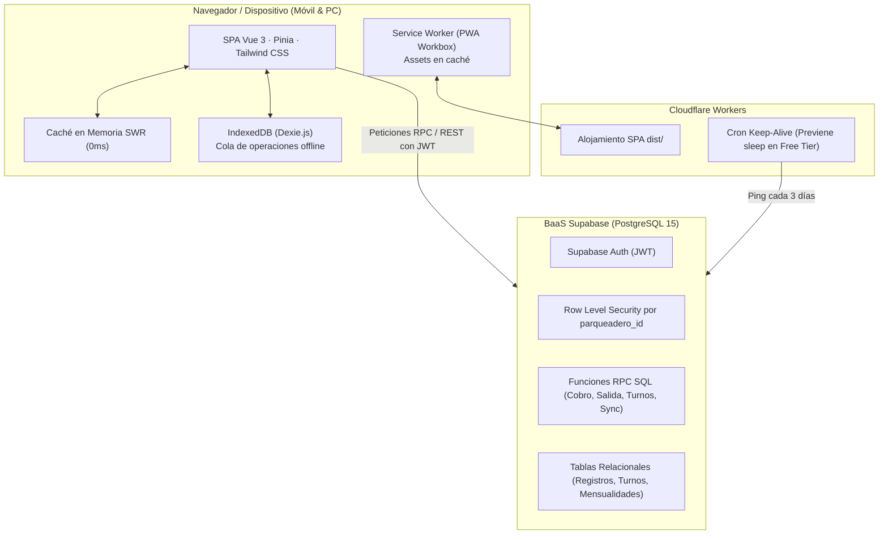

# ParkControl · Documento Maestro y Memoria Integral del Proyecto

> **Versión del Sistema:** 1.0.0-beta  
> **Fecha de Actualización:** 11 de Noviembre de 2026  
> **Arquitectura:** Progressive Web App (PWA) Multi-Tenant · Offline-First · Serverless  
> **Stack Base:** Vue 3 (Composition API) + Vite 5 + Tailwind CSS + Supabase (PostgreSQL 15) + Cloudflare Workers  

---

## 1. Visión General y Propósito del Negocio

**ParkControl** es una plataforma SaaS multi-parqueadero diseñada para sustituir los cuadernos físicos de registro en estacionamientos de Colombia por una solución digital rápida, táctil y resiliente a caídas de internet.

### 1.1 Problemas que Resuelve
1. **Falta de visibilidad operativa:** Se desconocía qué vehículos estaban dentro en tiempo real y la disponibilidad exacta de cupos por tipo de vehículo.
2. **Cálculo manual propenso a pérdidas:** El cobro por tiempo se hacía a mano con tarifas variables, provocando cobros erróneos o fugas de dinero.
3. **Descontrol en mensualidades:** Clientes con mensualidades vencidas seguían ingresando al parqueadero sin que el cajero lo supiera.
4. **Cierres de turno ciegos:** Dificultad para cuadrar el efectivo físico recibido frente al sistema y conciliar las entregas de turno entre operarios.
5. **Vulnerabilidad a cortes de red:** Si la conexión a internet fallaba, la portería no podía detenerse.

### 1.2 Reglas de Negocio Fundamentales
* **Minutos de Gracia = 0:** No existe tiempo de gracia al entrar. Desde el minuto 1 de ingreso inicia el cómputo del tiempo y el cobro del vehículo.
* **Caja Obligatoria:** No se puede cobrar ninguna salida de vehículo ni pago de mensualidad en efectivo si no existe un turno de caja abierto en Supabase.
* **Tolerancia de Capacidad:** La capacidad informa y alerta al operario, pero no bloquea el ingreso (soporte para sobrecupo justificado).
* **Paridad 1:1 Servidor/Cliente:** El mismo algoritmo de cálculo de cobros y clasificación de mensualidades corre en PostgreSQL (RPC) y en JavaScript puro (`src/domain/`), garantizando consistencia total en operaciones offline y online.

---

## 2. Roles de Usuario y Matriz de Acceso

El sistema maneja un modelo de aislamiento estricto por parqueadero (`parqueadero_id`) respaldado por **Row Level Security (RLS)** en PostgreSQL:

| Rol | Alcance | Capacidades Principales |
| :--- | :--- | :--- |
| **Superadmin** | Global (Multi-Tenant) | Crear parqueaderos, suspender o activar tenants, gestionar credenciales maestras. No interfiere en la operativa interna del patio. |
| **Administrador** | Tenant (Parqueadero) | Todo dentro de su parqueadero: configurar tarifas, tipos de vehículos, planes mensuales, usuarios del parqueadero, consultar reportes de ingresos, anular registros con motivo justificado. |
| **Operador (Cajero)** | Tenant (Parqueadero) | Operación diaria de patio: registrar entradas, cobrar salidas con cálculo de cambio, cobrar mensualidades, registrar notas de aviso, abrir/entregar turno de caja. |

---

## 3. Arquitectura del Sistema



---

## 4. Memoria Histórica de Decisiones Técnicas

### 4.1 Base de Datos Multi-Tenant & RLS Robusto
* **Decisión:** Cada tabla de negocio incluye la columna `parqueadero_id REFERENCES public.parqueaderos(id)`.
* **Seguridad:** Se implementó la función SQL `public.mi_parqueadero_id()` que extrae el `parqueadero_id` del usuario autenticado en `public.profiles`. Todas las políticas RLS utilizan esta función para impedir que un usuario vea datos de otro tenant.
* **Funciones `SECURITY DEFINER`:** Las operaciones transaccionales complejas (cobro de salida, liquidación de turno, sincronización en lote) se ejecutan mediante RPCs de PostgreSQL con control de concurrencia y validaciones a nivel de servidor.

### 4.2 Módulo de Patio & Ocupación en Tiempo Real
* **Registro de Entrada (< 5 segs):** El cajero ingresa la placa; el sistema detecta o autoselecciona el tipo de vehículo y genera el registro.
* **Liquidación de Salida:** Calcula el tiempo transcurrido en minutos y aplica la modalidad de cobro (`por_hora`, `por_minuto`, `fraccion_15m`, `pleno`).
* **Resolución del falso positivo "Offline":** Inicialmente se marcaban autos con badge "Offline" por comparar `hora_origen === 'dispositivo'`. Se corrigió para evaluar exclusivamente la conectividad real y el estado `pendiente_sync`, evitando confusiones en el operador.
* **Vinculación obligatoria con Turno Real:** Al cobrar un vehículo, PostgreSQL requería un registro en `turnos_caja` abierto. Se sincronizó la apertura automática de turno con base inicial ($50.000 COP por defecto si no existía) para evitar excepciones en la RPC `registrar_salida`.

### 4.3 Caja y Turnos de Relevo
* **Flujo de Arqueo:**
  1. **Apertura:** Se registra la base inicial en efectivo (`abrir_turno`).
  2. **Operación:** Cada salida en efectivo incrementa automáticamente el `efectivo_esperado`. Los retiros o ingresos manuales quedan auditados en `movimientos_caja`.
  3. **Entrega de Turno:** El cajero saliente cuenta su efectivo físico (`efectivo_contado`). El sistema pasa a estado `por_recibir` y calcula la `diferencia` (faltante o sobrante).
  4. **Recepción:** El cajero entrante confirma el monto recibido y el turno anterior se cierra definitivamente, iniciando el nuevo ciclo.

### 4.4 Mensualidades y Cobro Preventivo
* **Clasificación Automática de Cartera:**
  * **Rojo (Vencidas):** Fecha de vencimiento superada. Muestra días de mora acumulados.
  * **Amarillo (Por vencer):** Vence hoy o en los próximos 7 días calendario.
  * **Verde (Al día):** Vigente sin acciones pendientes.
* **Acceso Directo a WhatsApp:** Generación de enlaces directos `https://wa.me/57...` con mensaje pre-redactado profesional que incluye nombre del abonado, placa del vehículo, días de mora/vencimiento y valor exacto a renovar en COP.

### 4.5 Resiliencia Offline-First & Clock Drift
* **Dexie.js (IndexedDB):** Si se cae la red, entradas y salidas se encolan en la base local del navegador con un UUID generado por el cliente.
* **Compensación de Reloj (Clock Drift):** Para evitar desajustes si el dispositivo del operario tiene la hora adelantada o atrasada, se calcula el desfase entre la hora local y `clock_timestamp()` de PostgreSQL, aplicando el ajuste en cada marca de tiempo.
* **Idempotencia:** Al restablecerse la red, `sincronizar_operaciones` procesa la cola sin duplicar cobros ni generar dobles entradas.

### 4.6 Rendimiento y Carga Instantánea (SWR + KeepAlive)
* **Problema:** En conexiones lentas, cambiar de vista tomaba entre 400ms y 700ms mostrando estados de carga repetitivos.
* **Solución Implementada:**
  1. **Caché en Memoria SWR (0ms):** Los servicios exponen un caché reactivo inmediato (`obtenerVehiculosDentroCache()`, `obtenerMensualidadesCache()`). La vista pinta los datos en 0ms y revalida en segundo plano silenciosamente.
  2. **Vue `<keep-alive>`:** Los componentes de las rutas principales se mantienen montados en memoria, eliminando re-renders destructivos.
  3. **Precarga en segundo plano:** Tras el login, la aplicación precalienta el estado de patio, mensualidades y caja en background.

### 4.7 Rediseño Artesanal *Warm Mobility Atelier*
A través de las directrices de las skills `frontend-design` y `tailwind-patterns`, se erradicó la apariencia de "plantilla genérica de IA":
* **Placas Colombianas Auténticas (`.plate-colombia`):** Acabado amarillo reflectivo con relieve 3D, bisel metálico, tornillos emulados y tipografía condensada de alta visibilidad.
* **Paleta Pastel Especializada:** Tonos suaves (menta `#ecfdf5`, ámbar `#fffbeb`, cielo `#f0f9ff`, coral `#fff1f2`) combinados con un fondo cálido `#f8fafc`.
* **Tiempo Legible para Humanos:** Muestra `17h 17m` en vez de `1037 min`.
* **Botonera Táctil de Billetes Colombianos:** En el modal de cobro, el operario cuenta con botones de un toque (`Exacto`, `$10k`, `$20k`, `$50k`, `$100k`) y cálculo automático de cambio a devolver en pantalla verde.

---

## 5. Esquema de Base de Datos (PostgreSQL)

### 5.1 Tablas Principales
```
public.parqueaderos
  ├── id (uuid, PK)
  ├── nombre (text)
  ├── nit (text)
  ├── telefono, direccion, ciudad
  ├── estado (activo / suspendido)
  └── created_at (timestamptz)

public.profiles
  ├── id (uuid, PK -> auth.users)
  ├── parqueadero_id (uuid -> parqueaderos)
  ├── nombre, telefono
  ├── rol (superadmin, admin, operador)
  └── created_at (timestamptz)

public.tipos_vehiculo
  ├── id (uuid, PK)
  ├── parqueadero_id (uuid -> parqueaderos)
  ├── nombre (Carro, Moto, Bicicleta, etc.)
  ├── capacidad (integer)
  └── orden (integer)

public.tarifas
  ├── id (uuid, PK)
  ├── parqueadero_id (uuid -> parqueaderos)
  ├── tipo_vehiculo_id (uuid -> tipos_vehiculo)
  ├── modalidad (por_hora, por_minuto, fraccion_15m, pleno)
  ├── valor (numeric)
  ├── minutos_gracia (integer = 0)
  └── activa (boolean)

public.registros (Patio de Parqueo)
  ├── id (uuid, PK)
  ├── parqueadero_id (uuid -> parqueaderos)
  ├── placa (text, indexada)
  ├── tipo_vehiculo_id (uuid -> tipos_vehiculo)
  ├── tarifa_id (uuid -> tarifas)
  ├── turno_id (uuid -> turnos_caja)
  ├── entrada_at (timestamptz)
  ├── salida_at (timestamptz)
  ├── valor (numeric)
  ├── estado (abierto / cerrado / anulado)
  ├── hora_origen (servidor / dispositivo)
  └── motivo_anulacion (text)

public.turnos_caja
  ├── id (uuid, PK)
  ├── parqueadero_id (uuid -> parqueaderos)
  ├── cajero_id (uuid -> profiles)
  ├── base_inicial (numeric)
  ├── efectivo_esperado (numeric)
  ├── efectivo_contado (numeric)
  ├── diferencia (numeric)
  ├── estado (abierto / por_recibir / cerrado)
  ├── abierto_at (timestamptz)
  └── cerrado_at (timestamptz)

public.mensualidades
  ├── id (uuid, PK)
  ├── parqueadero_id (uuid -> parqueaderos)
  ├── cliente_id (uuid -> clientes)
  ├── vehiculo_id (uuid -> vehiculos)
  ├── plan_id (uuid -> planes_mensuales)
  ├── fecha_inicio (date)
  ├── fecha_fin (date)
  ├── dia_corte (integer)
  └── activa (boolean)
```

---

## 6. Estructura de Directorios del Proyecto

```
AI PARKCONTROL/
├── .gemini/skills/            # Skills de diseño e ingeniería
│   ├── frontend-design/       # Estándar de diseño y diferenciación visual
│   ├── tailwind-patterns/     # Patrones modernos de Tailwind v4/v3 tokens
│   ├── postgres-best-practices/
│   └── tdd-workflow/
├── public/                    # Favicon, manifest web y cabeceras
├── src/
│   ├── assets/                # main.css (Tokens pasteles, placas, botones craft)
│   ├── domain/                # Lógica pura de negocio (agnóstica del framework)
│   │   ├── cobro.js           # Cálculo de tarifas y fracciones
│   │   ├── cobro.test.js      # Pruebas unitarias de liquidación
│   │   ├── estadoMensualidad.js
│   │   ├── periodo.js         # Cálculo de periodos y bisiestos
│   │   └── periodo.test.js
│   ├── layouts/
│   │   └── AppLayout.vue      # Header con baliza en vivo y sidebar categorizado
│   ├── modules/
│   │   ├── ajustes/           # Configuración de tarifas, vehículos y negocio
│   │   ├── auth/              # Login y recuperación de sesión
│   │   ├── caja/              # Arqueo de turnos y movimientos de efectivo
│   │   ├── comprobantes/      # Comprobantes y generación PDF
│   │   ├── dashboard/         # Semáforo de cobro y resumen diario
│   │   ├── mensualidades/     # Agenda de vencimientos y carné de abonado
│   │   ├── ocupacion/         # Patio en vivo, bento de cupos y cobro táctil
│   │   ├── reportes/          # Métricas e informes exportables
│   │   └── superadmin/        # Gestión multi-tenant
│   ├── offline/               # Motor sin conexión
│   │   ├── clockDrift.js      # Corrección de desfase horario cliente/servidor
│   │   ├── cola.js            # Cola de mutaciones pendientes
│   │   ├── db.js              # Base de datos Dexie (IndexedDB)
│   │   └── sync.js            # Sincronización en segundo plano
│   ├── stores/                # Estados globales con Pinia
│   │   ├── auth.js            # Perfil, rol y parqueadero activo
│   │   ├── conexion.js        # Estado online/offline y cola pendiente
│   │   └── tema.js            # Switcher claro/oscuro
│   ├── utils/                 # Utilidades generales
│   │   ├── numeroALetras.js   # Conversión de pesos COP a texto legal
│   │   └── placa.js           # Normalización de placas colombianas
│   ├── App.vue                # Raíz con KeepAlive global
│   └── main.js                # Inicialización de Vue, Pinia y PWA
├── supabase/
│   ├── migrations/            # Migraciones SQL versionadas
│   ├── full_schema.sql        # Esquema completo consolidado
│   └── seed.sql               # Datos iniciales para pruebas
├── PLAN_V2.md                 # Especificación técnica original y HU
├── package.json               # Dependencias del proyecto
├── tailwind.config.js         # Configuración de variables semánticas
├── vite.config.js             # Configuración de Vite y PWA Workbox
└── vitest.config.js           # Configuración de la suite de pruebas unitarias
```

---

## 7. Suite de Pruebas Unitarias (Vitest)

El proyecto cuenta con **30 pruebas unitarias automatizadas** que respaldan la estabilidad de la lógica financiera y de sincronización:

| Módulo Probado | Archivo de Prueba | Casos Cubiertos |
| :--- | :--- | :--- |
| **Cálculo de Cobro** | `cobro.test.js` | Cobro exacto por hora, fracciones de 15m, tarifas plenas, minutos de gracia en 0, redondeos en COP. |
| **Estados de Mensualidad** | `estadoMensualidad.test.js` | Clasificación en semáforo (rojo/amarillo/verde), conteo de días de mora, detección de vencimiento hoy. |
| **Periodos y Fechas** | `periodo.test.js` | Manejo de meses de 28, 30 y 31 días, años bisiestos, días de corte fijos. |
| **Desfase Horario** | `clockDrift.test.js` | Detección de desfase > 5 min, ajuste automático de timestamps locales. |
| **Cola Offline** | `cola.test.js` | Encolado en Dexie, generación de UUID cliente, marcaje de operaciones pendientes. |
| **Normalización de Placas** | `placa.test.js` | Limpieza de espacios, guiones, validación de formatos de carro y moto en Colombia. |
| **Número a Letras** | `numeroALetras.test.js` | Conversión de montos en pesos colombianos para comprobantes fiscales. |
| **Autenticación** | `authService.test.js` | Manejo de sesión, roles y parqueadero activo. |

---

## 8. Guía de Ejecución y Despliegue

### 8.1 Requisitos Previos
* Node.js `>= 18.x`
* Cuenta de Supabase con proyecto activo.

### 8.2 Variables de Entorno (`.env`)
```env
VITE_SUPABASE_URL=https://nielrynhqnwiygrvmyny.supabase.co
VITE_SUPABASE_ANON_KEY=tu_clave_anon_de_supabase
```

### 8.3 Comandos del Sistema
```bash
# Instalar dependencias
npm install

# Iniciar servidor de desarrollo con HMR
npm run dev

# Ejecutar suite de pruebas unitarias
npm run test

# Compilar para producción (genera PWA y service worker)
npm run build

# Previsualizar la compilación de producción
npm run preview
```

---

## 9. Estado Actual del Proyecto

* **Patio de Parqueo:** 100% operativo con placas colombianas auténticas, tiempos humanizados (`17h 17m`) y modal de cobro con calculadora de cambio rápido.
* **Mensualidades:** 100% operativo con carné de abonado, semáforo de vencimientos y enlace de 1 clic a WhatsApp.
* **Caja:** 100% operativo con apertura obligatoria de turno, conciliación de relevos y trazabilidad de efectivo.
* **Rendimiento:** 0ms en navegación interna gracias a memoria reactiva SWR y Vue KeepAlive.
* **Pruebas:** 30 de 30 tests pasando (`Vitest v2.1.9`). Build de producción limpio en 5.9 segundos.
